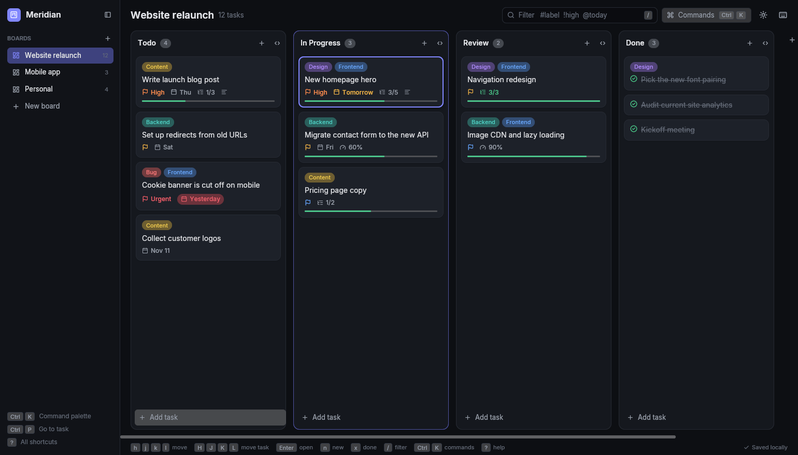
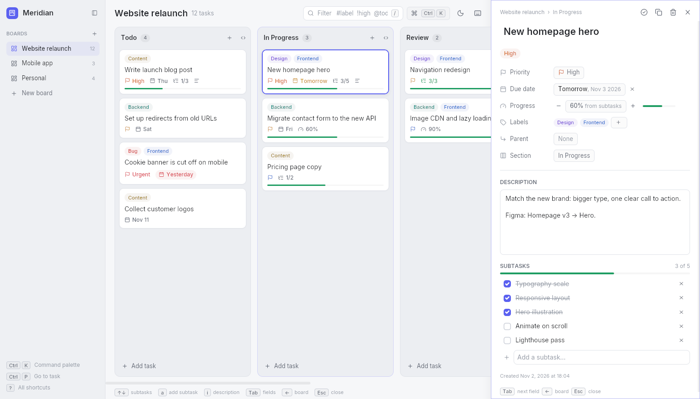
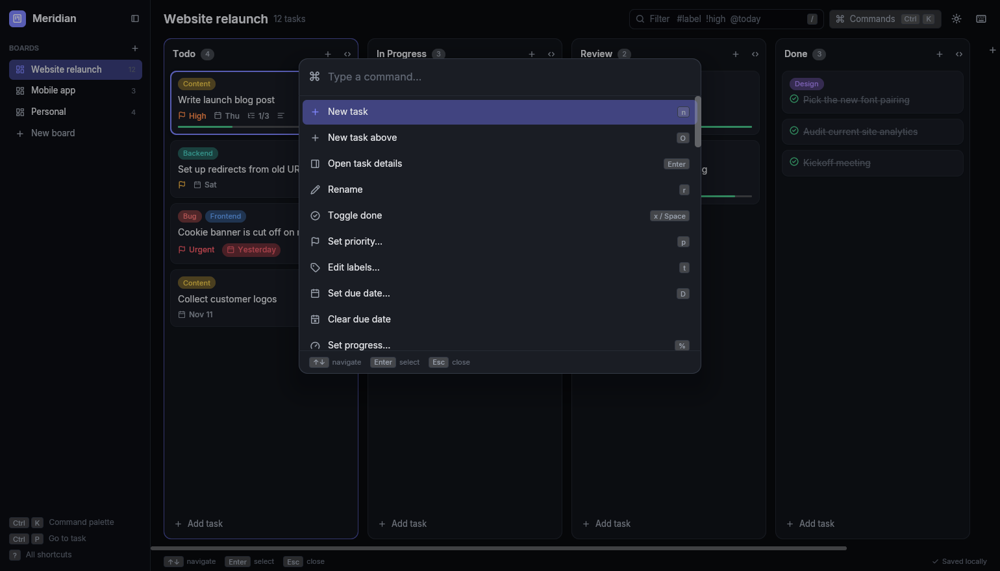

# Meridian

A fast, keyboard-first, fully offline Kanban board for the desktop, written in Rust with [iced](https://iced.rs).



- Boards → sections → tasks, with descriptions, subtasks, labels, priorities, due dates and progress
- Settings for theme, card density, date style, week start and more (`Ctrl+,`)
- Everything works from the keyboard (vim keys and arrows), plus a fuzzy command palette (`Ctrl+K`)
- Mouse drag and drop for tasks and sections
- Unlimited undo/redo for every change
- Dark and light themes that follow the system
- Data is stored locally in SQLite: `~/.local/share/meridian/meridian.db`

| Task details (light theme) | Command palette |
|---|---|
|  |  |

> Only tested on Linux (Wayland and X11). It may build on macOS and Windows, but that's untested.

## Install

Download the latest Linux build from the [Releases page](https://github.com/ShaderCompilation/Meridian/releases), unpack it and run the installer:

```sh
tar -xzf meridian-*-x86_64-linux.tar.gz
cd meridian-*-x86_64-linux
tools/install.sh
```

## Build & run

```sh
cargo run --release
```

Building needs Rust 1.90 or newer, and on Linux a C compiler (`gcc`) for the bundled SQLite.

To build and install it for your user (binary in `~/.local/bin`, plus a desktop entry and icon):

```sh
tools/install.sh            # install
tools/install.sh uninstall  # remove (your data is kept)
```

Environment variables:

| Variable | Purpose |
|---|---|
| `MERIDIAN_DB` | Use a different database file |
| `ICED_BACKEND=tiny-skia` | Use the software renderer instead of the GPU |
| `WGPU_BACKEND=gl` | Use OpenGL instead of Vulkan |

## Keyboard

Press `?` (or `F1`) in the app for the full cheat sheet. The same keys mean the same thing everywhere:

- **Arrows / `hjkl`** move inside whatever has focus. **Shift** (or `HJKL`) moves the item itself.
- **Enter** opens or confirms. In a text field it saves.
- **Esc** goes back exactly one step: cancel a drag → close a dialog → leave a field → deselect a subtask → back to the parent task → close the panel → clear the filter.
- **Tab** moves into the task panel and through its fields; **Shift+Tab** goes back.
- Task keys (`x`, `p`, `t`, `D`, `dd`…) act on what's highlighted: the selected card, or in the panel the selected subtask (else the open task).

The essentials:

| Keys | Action |
|---|---|
| `h j k l` / arrows | Move between sections and tasks |
| `Home` / `End`, `gg` / `G` | First / last task in the section |
| `H J K L` / `Shift+arrows` | Move the selected task (or section) |
| `Enter` / `e` | Open task details (section header: rename; collapsed section: expand) |
| `n` / `o`, `O` | New task below / above (Enter keeps adding) |
| `N` | New section |
| `x` / `Space` | Toggle done (moves the task to the “Done” section) |
| `dd` / `Delete` | Delete task or section |
| `p` (then `0–4` to set it directly) | Priority |
| `t` | Labels |
| `D` | Due date (`today`, `tom`, `fri`, `+3d`, `2w`, `nov 3`…) |
| `%` | Set progress (type a percentage) |
| `+` / `-` | Progress up / down by 10% |
| `m` | Move to section |
| `y` | Duplicate |
| `z` | Collapse / expand section |
| `/` | Filter: words, `#label`, `!high`, `@today`, `@overdue`, `@week`, `@done`… |
| `Ctrl+K` / `:` | Command palette |
| `Ctrl+P` | Go to any task |
| `b`, `Ctrl+1…9`, `[` `]` | Switch boards |
| `u` / `Ctrl+Z`, `U` / `Ctrl+Shift+Z` | Undo / redo |
| `Ctrl+B` | Toggle sidebar |
| `Ctrl+Shift+L` | Toggle light / dark |
| `Ctrl+,` | Settings |

Progress you set by hand overrides the subtasks; “Reset progress to subtasks” (in the palette, or the `×` in task details) goes back to automatic.

In the task panel: `↑/↓` navigate the property rows and subtasks; `↓` from the title selects Priority, and `Enter`/`Space` edits the highlighted property. `j/k` select subtasks (`↓` past the last one goes to “Add a subtask”), `Enter` opens one, `Space`/`x` toggles, `J/K` reorders, `r` renames, `dd`/`Delete` deletes, `a` adds, `i` edits the description. `Tab` cycles title → description → add subtask. `←` hands the keyboard back to the board while the panel stays open and follows the selection; `Enter` or `Tab` goes back in. `Esc` deselects, then goes back to the parent task, then closes.

While typing: `Enter` saves (for new tasks and subtasks it adds the next one), `Esc` cancels (fields in the task panel are saved as you type, so `Esc` keeps them), `Ctrl+Enter` saves and leaves any field, `Tab` moves on. In the filter, `Enter` keeps the filter and `Esc` clears it.

## Development

```sh
cargo test
cargo clippy
```

`tools/shoot.sh <dir> "<script>"` drives the UI with a scripted sequence of keys and saves screenshots
(see `src/devtools.rs` for the script syntax), e.g.:

```sh
tools/shoot.sh /tmp/shots "j;l;Enter;wait:300;shot:detail;Esc;C-k;shot:palette;quit"
```

## Layout

```
src/
  main.rs       window setup, fonts
  app.rs        state, messages, update loop, keyboard handling, data operations
  model.rs      data types, in-memory store, ordering
  db.rs         SQLite schema, migrations, persistence
  palette.rs    command palette modes, fuzzy ranking, actions
  settings.rs   user preferences and how they are stored
  commands.rs   command registry (palette + cheat sheet)
  filter.rs     filter query language
  dates.rs      natural-language dates
  theme.rs      design tokens and widget styles
  ui/           views (board, cards, detail panel, palette, sidebar, help)
```

## License

MIT, see [LICENSE](LICENSE). Bundled fonts: [Inter](https://rsms.me/inter/) (SIL Open Font License, `assets/fonts/Inter-LICENSE.txt`) and [Lucide](https://lucide.dev) icons (ISC, `assets/fonts/Lucide-LICENSE.txt`).
